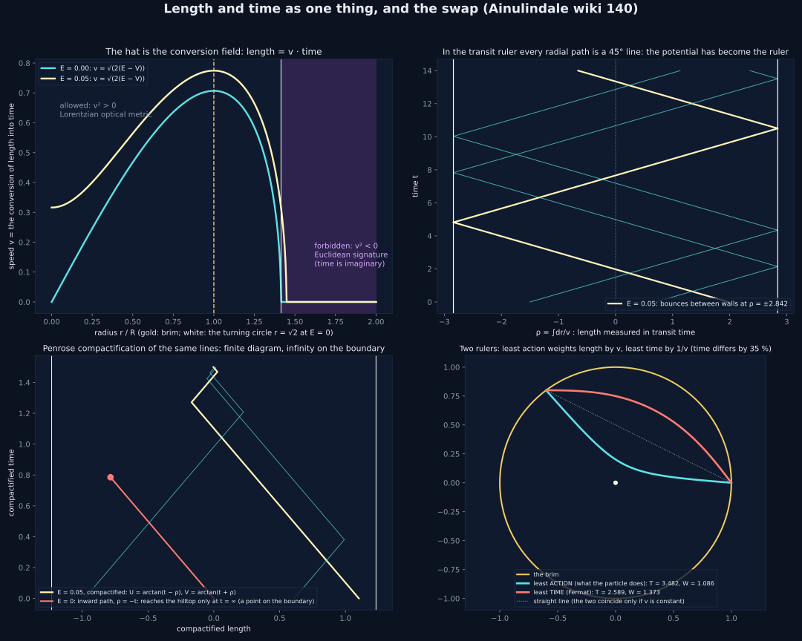

# 140 — Length and Time as One Thing, and the Swap

| | |
|---|---|
| Written | 2026-11-19 |
| Scope | a definition of how length and time are the same thing in any space that has a propagation speed; what the Penrose swap of time and space is in that definition; how it connects to the Smith-chart compactification of the Scale engine. Tested on the Witch's Hat |
| Requested by | Cody, 2026-11-19: "I need a definition of how length and time are the same thing, and how that factors into the Penrose space swap of time and space; both are emergent from any space; to fully describe the space you have to know how long it takes to get from point A to point B, necessitating a length and a time" |
| Predecessors | [110](110_qm_in_gr_gr_in_qm.md) (the native coordinate u = ln x) · [112](112_sullivan_dictionary.md) (Smith chart and gasket) · [139](139_three_lagrangians.md) §§11–12 (the paths and the cone) · [64](64_l_dynamic.md) |
| Code | `ValaQuenta/modules/witches_hat/length_time.py` · tests `ValaQuenta/Testing/test_witches_hat_length_time.py` (9, all pass) · figure `images/140_length_time.svg` (generator and every measurement: `ContextPlease/claude/scratchpad/2026-11-19_lagrangian_sm/`) |
| Confidence | §2 (definition and tests): `ESTABLISHED` mathematics, `:CALCULATED` on the hat · §4–§5 (the swap, Penrose = Smith under ρ → it): the identities are `ESTABLISHED`, the identification is `INTERPRETATION` · §6: `CONJECTURE` |

> **Note from the assistant.** Written by a transformer (Claude Sonnet 5.5, `claude-sonnet-5-5`) working with Cody Allison in Claude Code, with the `cs-paper-code-conventions` skill loaded. Cody does not tell the model what result he wants. Every number below comes from the code named above, and where a test failed first, the failure and its source are stated (§7). The physics used is textbook (Hamilton–Jacobi, Fermat and Maupertuis, the optical metric, the Wick rotation, the Gudermannian function); the identifications in §5 and the conjecture in §6 are the author's questions, tested where they can be.

## 1. The question

To describe a space you need more than where its points are. You need how long it takes to get from A to B. That is two numbers for one displacement: a **length** (how far) and a **time** (how long), and neither fixes the other until the space says how fast things move in it. So the claim to define is: *length and time are the same thing, measured with two rulers that differ by the space's own conversion field.*

## 2. Definition

**Conversion field.** A space with a propagation speed field v(q) (the speed at which something travels there) converts length into time: dℓ = v dt. In relativity v = c is constant and the conversion is one number. In the Witch's Hat at energy E the field is **v(q) = √(2(E − V(q)))**: the potential V is the conversion field, and nothing outside the hat (no clock, no ruler) is supplied.

**Transit length.** The transit length of a path is ρ = ∫ ds / v: its length measured in time. In this ruler length and time are literally the same quantity: dρ = dt for anything propagating at v.

**Optical metric.** The pair (geometry ds², conversion field v) is equivalent to one Lorentzian metric, **g = −v(q)² dt² + |dq|²**. Every path of the hat at energy E is a **null curve** of g: |dq| = v dt, an interval of zero length. "Length equals time" is the null condition.

**Three statements of "the same thing"**, each tested (§3):

1. **Null.** Along every path, length = v · time.
2. **Conjugate.** t = ∂W/∂E, where W = ∫ p dq is the reduced action (the Jacobi length). One function W(q; E) carries both: its gradient is the momentum (length), its energy derivative is the transit time.
3. **Dual rulers.** Weighting a length by v gives the action; weighting it by 1/v gives the time. Inverting the conversion field exchanges them.

**Emergent from the space.** For any pair of points in the hat, the geometric distance, the path length, the action and the transit time all follow from V and E.

## 3. The tests (the hat: μ = λ = 1, brim radius 1, depth ¼)

```
>>> LT.radial_worldline(SM, 0.05, 6.0)['deviation']          # rho(r(t)) + t along a radial path
3.64e-12
>>> c = LT.conjugacy(SM, 0.05); c['t_reference'], round(c['dW_dE'], 6), c['relative_error']
(1.5, 1.5, 4.2e-08)
>>> b = LT.barrier_conjugacy(SM, 0.02); round(b['tau'], 6), round(b['dB_dE'], 6), b['relative_error']
(0.64284, -0.64284, 1.1e-08)
>>> r = LT.two_rulers(SM, (1,0), (-0.6,0.8), 0.05); round(r['T_of_action_path'],3), round(r['T_min'],3), round(r['split'],3), round(r['max_separation'],2)
(3.487, 2.589, 0.347, 0.54)
>>> LT.two_rulers(SM, (1,0), (-0.6,0.8), 0.05, constant_speed=True)['split']
1.9e-16
>>> h = LT.hilltop_clock(SM); [round(s, 4) for s in h['slopes']], round(h['W_to_hilltop'], 5)
([1.0005, 1.0, 1.0, 1.0], 0.43096)
>>> w = LT.wall_transit(SM, 0.0); round(w['r_turn'], 6), round(w['rho_brim_to_wall'], 6)
(1.414214, 0.881374)
```

- **The potential is the ruler.** Along a radial path ρ(r(t)) + t is constant to 4×10⁻¹²: in (ρ, t) every radial path is a straight 45° line. Light cones are 45° everywhere; the whole effect of the potential has gone into the coordinate change r → ρ (the tortoise coordinate of relativity).
- **Time is the energy derivative of the action,** on a non-radial path, to 4×10⁻⁸. A 1D check would be an identity; this is the engine's own W and t for a bent path, joined at fixed endpoints at E ± dE.
- **The two rulers disagree.** From (1, 0) to (−0.6, 0.8) at E = 0.05 the path the particle takes (least action) takes 3.487 time units; the path of least time takes 2.589, a different curve 0.54 brim radii away at its widest: the particle's path costs **35 % more time**. For a second pair the excess is 5 %. With a constant speed the two coincide to 10⁻¹⁶. Least action weights each length by v, so it is cheap where the particle is slow (the hill); least time weights by 1/v, so it prefers the fast trough. They agree only where v does not vary, which is the one case in which length and time are proportional. The size of the split measures how much the space distinguishes length from time.
- **Inverting v exchanges them.** With v → 1/v the least-action path of the inverted world is the least-time path of the original, and W and T swap (agreement 2×10⁻⁷ and 1×10⁻¹⁰ at N = 100).

## 4. Where the swap is

The conversion field is a real speed where E > V and imaginary where E < V. At E = 0 the signature of g, measured on the hat:

| r | 0 (hilltop) | 0.5 | 1.0 (brim) | 1.3 | 1.414 (= √2) | 1.6 |
|---|---|---|---|---|---|---|
| signature | cone closes | Lorentzian | Lorentzian | Lorentzian | cone closes | Euclidean |

Beyond r = √2, v² < 0: the optical metric has no timelike direction and real time becomes **imaginary** time τ (the Wick rotation). The relation of §2 continues across it: in the forbidden region the barrier action B = ∫√(2(V − E)) dr and the Euclidean time τ = ∫dr/√(2(V − E)) satisfy **dB/dE = −τ** (§3: −0.64284 against 0.64284, 10⁻⁸). The same conjugacy, with real time replaced by imaginary time: the swap is an analytic continuation, not a break.

The two kinds of boundary differ:

- **The turning circle is at finite transit time and length.** From the brim to r = √2 at E = 0 the transit is ρ = ln(1 + √2) = 0.881374 exactly (measured 0.881374, 4×10⁻⁹). It is a mirror.
- **The hilltop at E = 0 is at infinite transit time and finite length.** ρ grows like ln r with slope 1.0000 per e-fold (to r = 10⁻⁵ it is −11.67), while the action to reach it stays finite, W = 0.43096. It is not a wall; it is a point infinitely far in time and a finite distance in length: the role of i⁺ (future timelike infinity) in a Penrose diagram. In the compactified diagram (`images/140_length_time.svg`, lower left) the E = 0 inward path ends at a point on the boundary.

**The horizon property, classified.** The two kinds of boundary are the two kinds of zero of the conversion field. A *simple* zero, v ≈ κ|r − r_h|, is at infinite transit time: ρ ≈ (1/κ) ln|r − r_h|. A *square-root* zero, v ≈ √|r − r_h|, is at finite transit time. Measured (`zero_of_the_conversion_field`): the E = 0 hilltop is a simple zero with κ = dv/dr = 1.0000; the Schwarzschild exterior, with v = f = 1 − 2M/r, has a simple zero at the horizon with κ = f′(2M) = 1/(2M) = 0.5000 for M = 1 (its surface gravity is half of this); the turning circle is a square-root zero and its transit converges (0.268, 0.350, 0.376, 0.384 at distances 10⁻² … 10⁻⁵). So a horizon is a simple zero of the conversion field: the place where length stays finite and time becomes infinite. The author's reading (2026-11-19) is that the horizon *is* this time distortion, an exterior and not an interior space, and that we are on the interior side of a black hole at the end of its life and exit through the white hole: recorded as `INTERPRETATION` in `FourthAgePapers/WitchesHat/README.md` §11, with the standard picture it departs from. The measurement supports the first half (a horizon is where the conversion degenerates) and says nothing about which side we occupy.



## 5. The Penrose swap and the Smith chart: one map under ρ → it

A Penrose diagram compactifies the null coordinates u = t − ρ, v = t + ρ with arctan, so infinity becomes a finite boundary. The Scale engine's Smith chart compactifies a **length**, ρ = ln s (the native coordinate u = ln x of [110](110_qm_in_gr_gr_in_qm.md)), with tanh: Γ = tanh(ρ/2) = (s − 1)/(s + 1). Measured, to rounding:

- `tanh(i x/2) = i tan(x/2)` (2.8×10⁻¹⁴): the two compactifications are the same map under **ρ → i t**, which is the swap of length and time (the Wick rotation of §4).
- `2 arctan(tanh(x/2)) = arctan(sinh x)` (2×10⁻¹⁶): the Gudermannian function, the standard bridge between the circular compactification of a time and the hyperbolic compactification of a length.
- `(s − 1)/(s + 1) = tanh(ln(s)/2)` (2×10⁻¹⁶): the Smith map is the tanh of half a log-length.

So the earlier identification of the Smith chart with the (T, R) section of a Penrose diagram ([`~/.clauderc_user_provenance` §1.19]) has a precise form: **the Smith chart is the Penrose compactification with the length and time roles exchanged.** The chart's inversion z → 1/z (Γ → −Γ) has a counterpart in §3: v → 1/v exchanges the two rulers. `INTERPRETATION` that these are the same inversion; both are tested separately and not tied together here.

## 6. What is not shown, and a conjecture

- **The Schwarzschild-style swap is not what the optical metric does.** Across a black-hole horizon both g_tt and g_rr change sign, so the signature stays Lorentzian and t and r exchange roles. In −v²dt² + dr² only the time term changes sign, so the signature goes from (−,+) to (+,+): real time becomes imaginary, and no spatial direction becomes timelike. The Lorentzian version of the exchange needs the Eisenhart–Duval lift (an established construction in which the dynamics in V is a null geodesic in a Lorentzian space whose two null coordinates are the time t and the action). I have not tested that lift here.
- **Conformal fact.** In the (ρ, t) plane the metric is v²(ρ)(−dt² + dρ²): conformally flat, so null curves are 45° lines whatever v is. Exchanging ρ and t (and the overall sign, which leaves null curves and geodesics unchanged) turns the static conformal factor v²(ρ) into a time-dependent one, v²(t). `CONJECTURE`: the static hat and a hat whose conversion field depends on time are swap partners, which would place the original L_dynamic (a time-dependent background, wiki 51) as the swap image of the static L_SM hat. The paths (null curves) are the same in both; what differs is how W and T are assigned along them. Not tested.
- **No claim about physical spacetime.** The hat's v is the speed of a particle at fixed energy, not a limiting speed; "null" here means "moves at v", and a particle at energy E has no other speed.

## 7. Anomalies chased

| anomaly | source | status |
|---|---|---|
| inversion test failed at 1.8×10⁻⁶ against a tolerance of 10⁻⁶ | the optimiser's convergence: the two discrete functionals are identical by construction; the gap fell to 2×10⁻⁷ and 10⁻¹⁰ at N = 100 | tolerance set from the method; stated in the test |
| wall-transit test failed at 4×10⁻⁹ against 10⁻⁹ | quadrature accuracy near the square-root endpoint | tolerance set; stated |
| the least-action path costs 35 % more time than the least-time path | the two functionals weight the same length by v and by 1/v; with v constant the split is 10⁻¹⁶ | explained; it is the result |
| the closed form of the wall transit | ln(1 + √2) = 0.881373587; measured 0.881373583 | exact |
| `ρ(r) ≈ ln r − 0.158` near the hilltop at E = 0 | from the closed form ρ = ln r − ln(1 + √(1 − r²/2)) + ln(1 + 1/√2): constant −ln 2 + ln 1.7071 = −0.158; measured ρ(10⁻⁵) = −11.671, closed form −11.671 | exact |

## 8. Where this leaves the question

Length and time are one thing in the sense that matters: the space supplies a conversion field, and in the ruler it fixes (transit length) every path is a 45° line. They are conjugate (t = ∂W/∂E), and they are exchanged by inverting the conversion field. A space is fully described by the geometry and the conversion field together: the geometry alone gives the length and ignores V; the field alone gives the speeds and ignores the shape. The swap is the analytic continuation of the same relation through v = 0, where real time becomes imaginary; at an infinite-time, finite-length point (the E = 0 hilltop) it becomes the boundary of the compactified diagram. The Smith chart and the Penrose diagram differ by exactly that swap, ρ → it.

## Appendix — what in ContextPlease was used

ContextPlease is the project's public archive of the context a session needs to come up to speed: primers, scratchpads, skills and wiki mirrors. Used here: `ContextPlease/claude/scratchpad/2026-11-19_lagrangian_sm/` (the figure generator and the earlier measurements), the skill `spatial-simulation` (`references/spaces.md` §7: the orthogonal Smith charts, gauge space), `~/.clauderc_user_provenance` §1.19 (the three-ring Smith chart), `~/.clauderc_canonical_maths`, and the skills `cs-paper-code-conventions` and `spatial-simulation`.
